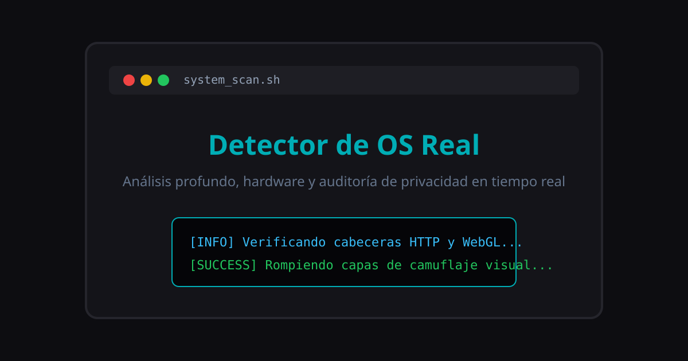

# 🖥️ Detector de OS Real e Inspección de Hardware

Una aplicación web interactiva y open-source diseñada para realizar un análisis profundo del entorno del navegador del usuario. El script analiza las variables de entorno para desenmascarar sistemas operativos clonados o modificados que intentan camuflarse como Windows, exponiendo la verdadera identidad de la plataforma.

---

## 🚀 Características del Proyecto

- **Secuencia de Inicialización:** Terminal simulada interactiva que procesa los registros de escaneo línea por línea en tiempo real.
- **Detección Avanzada de OS:** Identifica Windows (incluyendo entornos optimizados como Tiny10/Pro), distribuciones populares de Linux (Ubuntu, Arch, Mint, Debian, Fedora) y macOS/Android/iOS.
- **Inspección Cruzada de Arquitectura:** Discierne con precisión entre plataformas de `64-bit (x64)`, `32-bit (x86)` y arquitecturas `ARM`.
- **Detección de Entorno Virtualizado (VM):** Analiza los renderizadores WebGL para identificar máquinas virtuales (`VMware`, `VirtualBox`, `llvmpipe`, `SwiftShader`).
- **Extracción de Hardware:** Lee hilos lógicos del procesador (CPU), memoria RAM estimada y la resolución nativa de la pantalla del monitor.
- **Métricas del Sistema y Red:** Detecta el modo de color del sistema (Tema Oscuro / Claro) y el tipo estimado de conexión a Internet (`4G`, velocidad downlink).
- **Auditoría de Privacidad y Anti-Fingerprinting:** Detecta automáticamente si el navegador (como Firefox) enmascara o bloquea métricas de hardware por seguridad.
- **Tutoriales Interactivos Integrados:** Incluye guías desplegables para ayudar al usuario a configurar o deshabilitar bloqueos de privacidad (`privacy.resistFingerprinting` en `about:config`).
- **Filtro Anticamulaje:** Ejecuta validaciones secundarias para cazar núcleos Linux disfrazados bajo capas de personalización visual de Windows.
- **🔒 Política Estricta de Privacidad:** **Cero rastreo de IP.** La herramienta respeta completamente la privacidad del usuario y no obtiene ni expone direcciones IP, siendo 100% segura para creadores de contenido, streamers y la comunidad.

---

## 🎨 Metadatos y Diseño Visual

- **Favicon Vectorial SVG:** Identificación visual nativa en pestañas del navegador.
- **Tarjetas Open Graph & Twitter Cards:** Vista previa optimizada mediante `banner.svg` al compartir la URL en Discord, Twitter/X, Telegram y WhatsApp.

---

## 🛠️ Tecnologías Utilizadas

- **HTML5** - Estructura semántica del panel con integración de metadatos SEO y Open Graph.
- **CSS3** - Interfaz responsiva con temática cyberpunk/consola oscura, animaciones `fadeIn` y componentes de tutorial interactivo.
- **JavaScript (Vanilla)** - Interrogación de APIs avanzadas del navegador (`navigator.userAgent`, `navigator.deviceMemory`, `navigator.hardwareConcurrency`, `navigator.connection`, `WebGL` context y `matchMedia`).

---

## 💻 Desarrollador

Desarrollado con pasión por **anyelo888ra-ux**.
